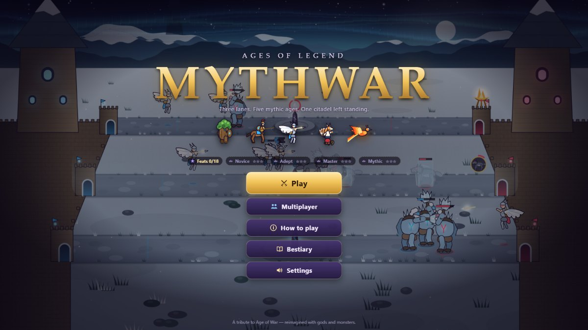
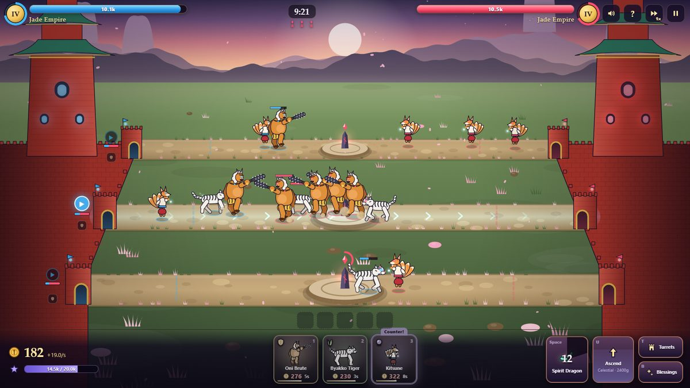
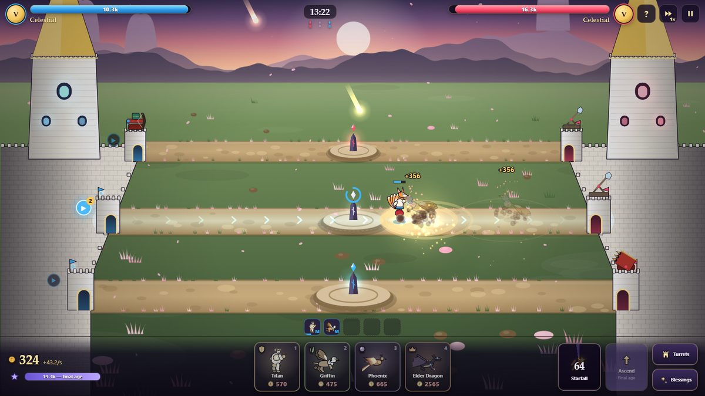
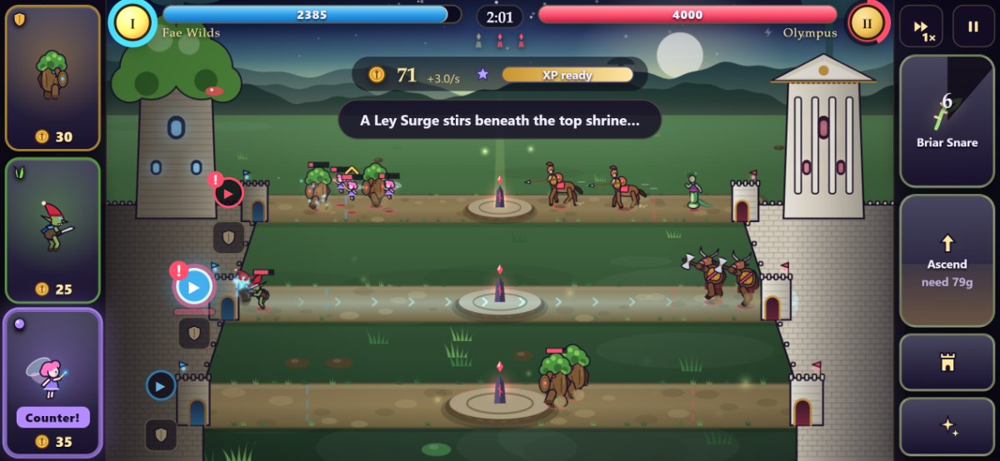
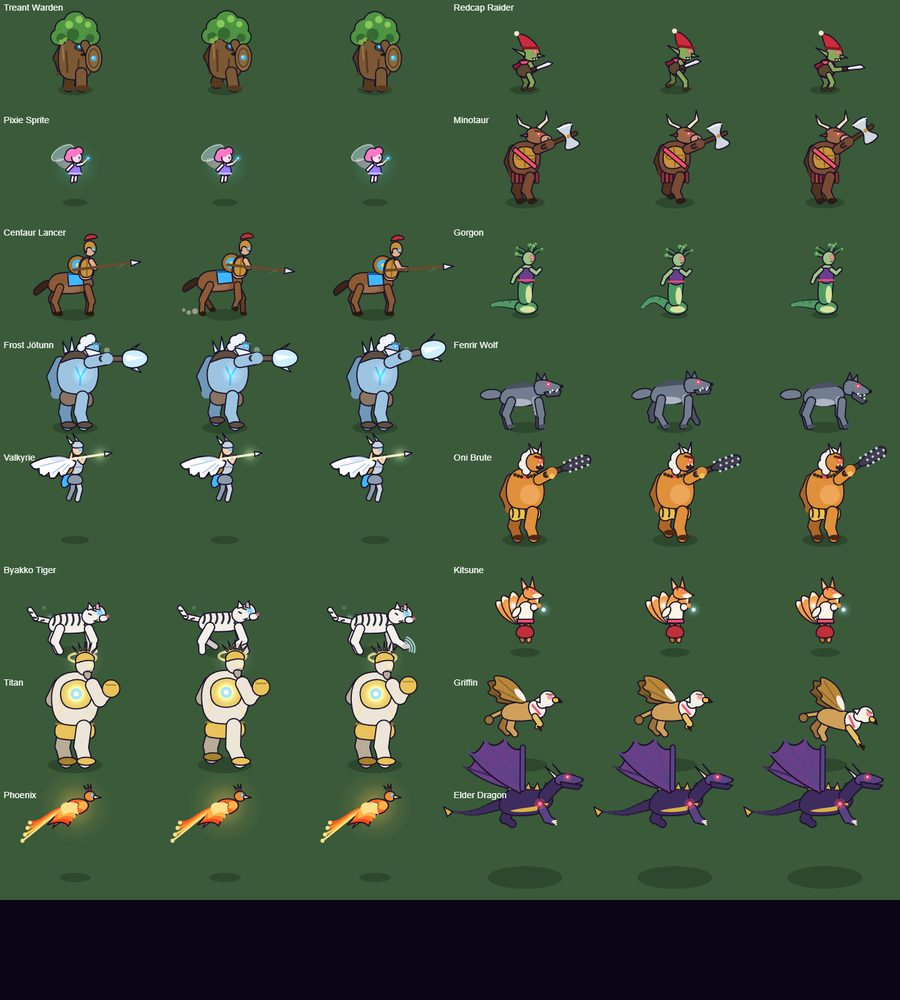

# Mythwar: Ages of Legend

A three-lane, mythological re-imagining of the Flash classic *Age of War*.
Summon creatures of legend into three lanes, out-counter your foe, hold the Ley Shrines,
ascend through five mythic ages — Fae Wilds, Olympus, Asgard, the Jade Empire and the
Celestial realm — and topple the enemy citadel.

Everything is procedural: all creatures, citadels and effects are drawn in code (Canvas 2D)
and all sound and music is synthesized with WebAudio. No asset files.



| Jade Empire battle | Starfall in the Celestial age |
|---|---|
|  |  |

| Phone (landscape thumb layout) | All 16 creatures (idle / walk / attack) |
|---|---|
|  |  |

## Run it

```bash
npm install
npm run dev        # http://localhost:5173
npm run build      # static build in dist/ (open via any static web server)
npm run preview    # serve the production build
```

To try it on a phone, run `npm run dev` and open the **Network** URL it prints on a phone
in the same Wi-Fi (landscape recommended; portrait is rotated automatically).

The build is a static site with a web manifest and offline service worker, so it can be
installed as an app on phones ("Add to Home Screen"), which also locks landscape.

## How to play

- **Goal:** destroy the enemy citadel. Its health is shared by all three lanes — so is yours.
- **Summon:** pick a lane (click/tap it or the ▶ marker at your gate), then tap a creature card.
  Or drag a card straight onto a lane.
- **Counter:** Guardians (shield) beat Hunters (fang), Hunters beat Mystics (orb), Mystics beat
  Guardians. Hunters strike as packs, Guardians' sweeping blows break packs, and Mystics hang
  back behind the front line. The card marked **Counter!** answers what's in your selected lane.
- **Economy:** gold trickles in and comes from kills. Hold the **Ley Shrine** in a lane's centre for
  extra income.
- **Ascend:** kills give XP; with enough XP and a gold tithe you advance to the next age (new
  creatures, turrets, god power, stronger citadel). The final age adds the Elder Dragon.
- **God powers:** one per age, recharging. Tap it, then a lane.
- **Turrets & blessings:** a turret per lane on your gates; blessings are permanent upgrades.
- **Ragnarök:** long wars end in Ragnarök — the gate wards fall silent and citadels crumble faster.

### Controls (desktop)

| Key | Action |
|---|---|
| 1 – 4 | Summon creature |
| W / S, ↑ / ↓, Q / A / Z | Select lane |
| Space | God power on the selected lane |
| U | Ascend |
| T / B | Turret / blessing panel |
| F | Toggle 2× speed |
| Esc / P | Pause |
| ? / H | Controls card |

On phones the creature cards sit under your left thumb and actions under your right; a
long-press on a card shows its details. Held upright, the game rotates into landscape.

## Difficulty

Novice, Adept, Master and Mythic AI opponents. They read lane threats, counter your creatures,
contest shrines, save up to ascend, build turrets, buy blessings and aim god powers. Mythic also
gets +20% income.

## Development

```bash
npm test                         # unit tests (simulation + AI)
npm run sim -- 20 master adept   # headless AI-vs-AI balance runs
node scripts/trace.ts 1003       # timeline of one headless match
node scripts/bots.ts 10          # AI difficulty vs scripted naive players
npm run smoke                    # end-to-end browser test (needs local Chrome)
npm run shoot -- desktop         # screenshots into screenshots/
node scripts/soak.ts 60 16       # long fast battles in Chrome: errors + fps
```

Battles autosave; "Continue" on the title screen resumes them.

Debug URLs: `?demo&ff=300&seed=5` (AI vs AI, fast-forwarded), `?play=adept`, `?screen=howto`,
`?gallery` (every creature's idle / walk / attack animation), `?mode=mobile`.

Code map: `src/sim` (deterministic simulation and all balance data), `src/ai` (opponent),
`src/render` (canvas renderer, creature art, effects), `src/ui` (HUD, menus, tips),
`src/audio` (synth), `DESIGN.md` (game design), `PROGRESS.md` (development log).
