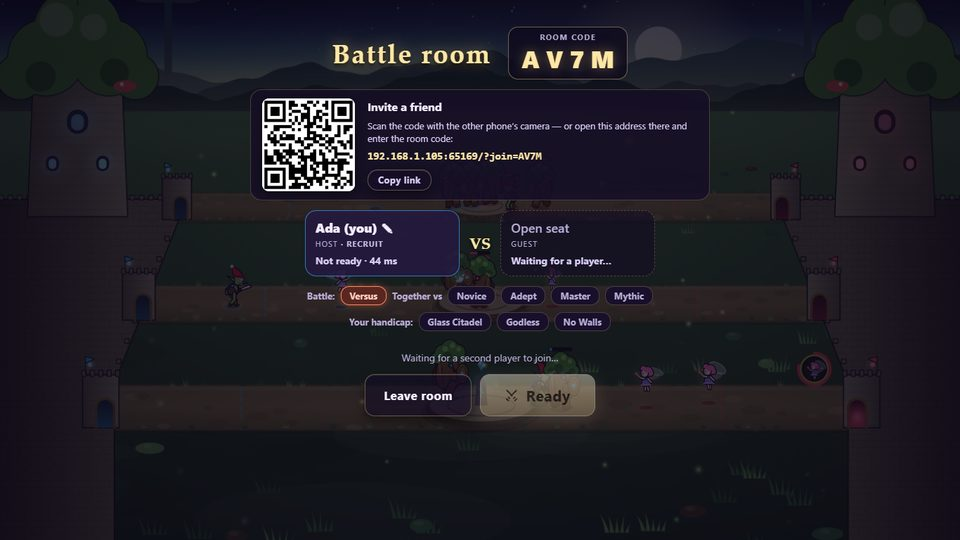
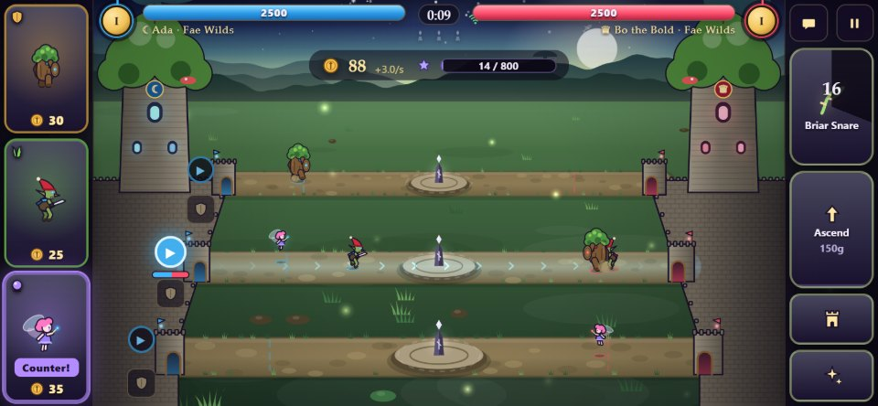

# Mythwar: Ages of Legend

A three-lane, mythological re-imagining of the Flash classic *Age of War*.
Summon creatures of legend into three lanes, out-counter your foe, hold the Ley Shrines,
ascend through five mythic ages — Fae Wilds, Olympus, Asgard, the Jade Empire and the
Celestial realm — and topple the enemy citadel.

Everything is procedural: all creatures, citadels and effects are drawn in code (Canvas 2D)
and all sound and music is synthesized with WebAudio. No asset files.

<a href="https://zahikusa.github.io/mythwar/"></a>

**▶ Play now: [zahikusa.github.io/mythwar](https://zahikusa.github.io/mythwar/)** — in any browser
on a PC, Mac, iPhone, Android phone or tablet. Nothing to install; scan the QR code with a phone.
For battles against a friend in the same Wi-Fi, see [Multiplayer](#multiplayer-same-wi-fi).


| Jade Empire battle | Starfall in the Celestial age |
|---|---|
|  |  |

| Phone (landscape thumb layout) | All 16 creatures (idle / walk / attack) |
|---|---|
|  |  |

## Install it as an app

The game at [zahikusa.github.io/mythwar](https://zahikusa.github.io/mythwar/) installs like an
app (own icon, fullscreen, landscape) and then also works offline. It updates itself.

- **iPhone / iPad:** open it in Safari → Share → *Add to Home Screen*.
- **Android:** open it in Chrome → ⋮ → *Add to Home screen* / *Install app*.
- **Windows / Mac:** Chrome or Edge → the install icon at the right of the address bar.

## Multiplayer (same Wi-Fi)

Battle a friend — PC, iPhone, Android, tablet, in any combination. One computer in the Wi-Fi
runs the small game server, and every device plays in its browser:

1. Download **mythwar-server-….zip** from the [latest release](https://github.com/Zahikusa/mythwar/releases/latest)
   on a Windows PC, Mac or Linux computer and unzip it.
2. Start it: **Windows** — double-click `Start Mythwar Server` (it offers to install
   [Node.js](https://nodejs.org/) if needed; if Windows warns about the file: *More info → Run
   anyway*; when the firewall asks, allow **private** networks). **macOS** — right-click
   `Start Mythwar Server.command` → *Open*. **Linux** — `sh start.sh`.
3. Scan the QR code it shows with each phone (or open the printed address in any browser).
4. **Multiplayer → Host a battle** on one device; the other scans the room's QR code or enters
   its code. Both press **Ready**.

From a checkout of this repository, `npm install` and `npm run lan` do the same (build + serve
on port 8787).

Fight each other, or **together against the AI** (choose "Together vs …" in the room: one shared
citadel and purse). Battles survive app switches, Wi-Fi blips and reloads; leaving forfeits. A stronger player can
take a handicap in the room (half a citadel, no god powers, no turrets) to give a friend a chance.
Details, troubleshooting (firewall!) and how it works: [docs/MULTIPLAYER.md](docs/MULTIPLAYER.md).

| Battle room: code + QR invite | The guest's phone: every player sees their own citadel on the left |
|---|---|
|  |  |

## How to play

- **Goal:** destroy the enemy citadel. Its health is shared by all three lanes — so is yours.
- **Summon:** pick a lane (click/tap it or the ▶ marker at your gate), then tap a creature card.
  Or drag a card straight onto a lane.
- **Counter:** Guardians (shield) beat Hunters (fang), Hunters beat Mystics (orb), Mystics beat
  Guardians. Hunters strike as packs, Guardians' sweeping blows break packs, and Mystics hang
  back behind the front line. The card marked **Counter!** answers what's in your selected lane.
- **Economy:** gold trickles in and comes from kills. Capture the **Ley Shrine** in a lane's centre
  (stand there with no foes nearby) for extra income until the enemy takes it back. Now and then a
  **Ley Surge** flares under one shrine: its holder earns a flood of gold for 20 seconds. Holding a
  shrine also gives *ley sight*: you see the enemy's next summons for that lane above their gate.
- **Read the enemy:** a gate's portal flares just before a creature steps out — watch the enemy
  gates to see which lane their next creature is coming down.
- **Ascend:** XP comes from kills, blows against the enemy citadel and time; with enough XP and a
  gold tithe you advance to the next age (new creatures, turrets, god power, stronger citadel).
  With three quarters of the XP you can *rush* it for a double tithe. The final age adds the
  Elder Dragon.
- **God powers:** one per age, recharging. Tap it, then a lane.
- **Turrets & blessings:** a turret per lane on your gates; blessings are permanent upgrades.
- **Ragnarök:** at 18:00 (or 3 minutes after both sides reach the final age) the gate wards fall
  silent and damage to citadels grows every minute.

- **Sandbox:** on the "Choose your foe" screen — no foe, endless gold, citadels that can't fall.
  Summon for either side (the "For:" button or X) and watch any match-up play out.
- **Quick battle:** a chip on the "Choose your foe" screen — XP ×2.2, 300 starting gold, Ragnarök at
  10:00 — the same five ages in roughly 10–11 minutes against Adept or Master instead of 14–16.
- **Trials:** on the "Choose your foe" screen — Glass Citadel (half health), Godless (no god
  powers), No Walls (no turrets) — for a harder battle; winning under all three is a feat.
- **Feats:** sixteen deeds to be proud of (beat each foe, summon the Elder Dragon, hold all three
  shrines, win from below 15%…) — the chip above the title menu lists them.
- **Bestiary:** the title screen and the pause menu open a bestiary of every creature, god power
  and turret, with the myths behind them. Ages you have never reached stay hidden until you do.

### Controls (desktop)

| Key | Action |
|---|---|
| 1 – 4 | Summon creature |
| W / S, ↑ / ↓, Q / A / Z, mouse wheel | Select lane |
| Space | God power on the selected lane |
| U | Ascend |
| T / B | Turret / blessing panel |
| G | Hold the selected lane at its shrine / advance (or the shield under a lane's ▶ marker) |
| F | Toggle 2× speed |
| Esc / P | Pause |
| ? / H | Controls card |

On phones the creature cards sit under your left thumb and actions under your right; a
long-press on a card shows its details. Held upright, the game rotates into landscape.

## Difficulty

Novice, Adept, Master and Mythic AI opponents. They read lane threats, counter your creatures,
contest shrines, save up to ascend, build turrets, buy blessings and aim god powers. AI gold income
(over time and from shrines): Novice 50%, Adept 90%, Master 100%, Mythic 120%. Mythic also
mounts turrets before you reach its gates and keeps its blessings coming.

A scripted "smart" player (follows the Counter! badge, casts powers, builds turrets, buys
blessings, saves to ascend) wins about 100% / 67% / 25% / 5% of games against Novice / Adept /
Master / Mythic over 300+ games each (`node scripts/calib.ts smart mythic 300`).

## Development

```bash
npm install
npm run dev                      # http://localhost:5173 (+ multiplayer; phones: open the Network URL)
npm run build                    # static build in dist/
npm run preview                  # serve the production build
npm run lan                      # build + LAN server with QR code on port 8787
npm run package                  # the release's server package → release/mythwar-server-v<version>.zip
npm test                         # unit tests (simulation + AI)
npm run sim -- 20 master adept   # headless AI-vs-AI balance runs
node scripts/trace.ts 1003       # timeline of one headless match
node scripts/bots.ts 10          # AI difficulty vs scripted players (naive → "smart")
npm run smoke                    # end-to-end browser test (needs local Chrome)
npm run shoot -- desktop         # screenshots into screenshots/ (--list, --size 2560x1440)
node scripts/soak.ts 60 16       # long fast battles in Chrome: errors + fps
npm run verify                   # typecheck + unit tests + build + smoke + multiplayer smoke
node scripts/mpsmoke.ts --shots  # two browsers play an online battle (screenshots/mp/)
node scripts/enginecheck.ts      # the simulation is identical in V8, SpiderMonkey and JavaScriptCore
node scripts/mpbot.ts            # an AI opponent that joins online rooms
node scripts/playthrough.mjs 90  # casual scripted play through the real UI, screenshots/play/
node scripts/perf2.mjs 1600 900  # per-frame render cost (supports skipping render passes)
node scripts/classwar.ts         # equal-gold army battles per class and age
npm run designcheck              # the design's success criteria (difficulty ladder, pacing, variety, fairness)
npm run perfcheck                # per-frame JavaScript cost of a busy late-game battle (budget 3 ms)
node scripts/calib.ts counter adept 90  # a scripted "follow the Counter! badge" bot vs an AI
node scripts/icons.mjs           # re-render PNG app icons (incl. maskable) from public/icon.svg
npm run ogcard                   # re-render the link-preview card public/og.jpg
npm run servercost               # bandwidth and CPU one online battle costs a server
```

Battles autosave; "Continue" on the title screen resumes them.

Debug URLs: `?demo&ff=300&seed=5` (AI vs AI, fast-forwarded), `?play=adept`, `?screen=howto`,
`?gallery` (every creature's idle / walk / attack animation), `?mode=mobile`.

### Publishing

- Every push to `master` runs the typecheck and unit tests and publishes the game on GitHub Pages
  (`.github/workflows/pages.yml`, built with `npm run build:pages` — that build has no game
  server, so its multiplayer lobby links to the server download instead).
- A version tag publishes the server package as a GitHub release (`.github/workflows/release.yml`):
  raise `version` in package.json, commit, then `git tag v1.1.0 && git push origin master v1.1.0`.

Code map: `src/sim` (deterministic simulation and all balance data), `src/ai` (opponent),
`src/net` + `server/` (multiplayer client and server),
`src/render` (canvas renderer, creature art, effects), `src/ui` (HUD, menus, tips),
`src/audio` (synth), `DESIGN.md` (game design), `PROGRESS.md` (development log).
**Working on the code? Read [CONTRIBUTING.md](CONTRIBUTING.md) first** — the determinism and
fairness rules, what to run for which change, and the checklist for adding a creature.

### Documents
| | |
|---|---|
| [docs/BRIEF.md](docs/BRIEF.md) | One page: what was asked, what was built, how to see it working |
| [docs/MULTIPLAYER.md](docs/MULTIPLAYER.md) | Wi-Fi play, troubleshooting, the netcode, going online |
| [DESIGN.md](DESIGN.md) | The game design (and [docs/LENSES.md](docs/LENSES.md): the reasoning behind 100 iterations) |
| [docs/PLAYTEST.md](docs/PLAYTEST.md) | A one-hour kit for testing with real people on real phones |
| [docs/ROADMAP.md](docs/ROADMAP.md) | Where it could go next |
| [docs/PITCH.md](docs/PITCH.md) · [docs/PROFIT.md](docs/PROFIT.md) | The pitch and store texts · what a server costs |
| [docs/PRIVACY.md](docs/PRIVACY.md) | What the game keeps, where, and who sees it |
| [CONTRIBUTING.md](CONTRIBUTING.md) | Rules and checklists for working on the code |
